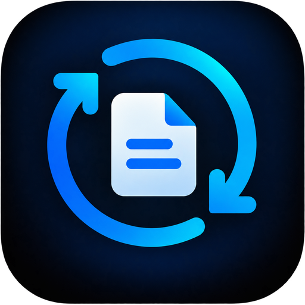
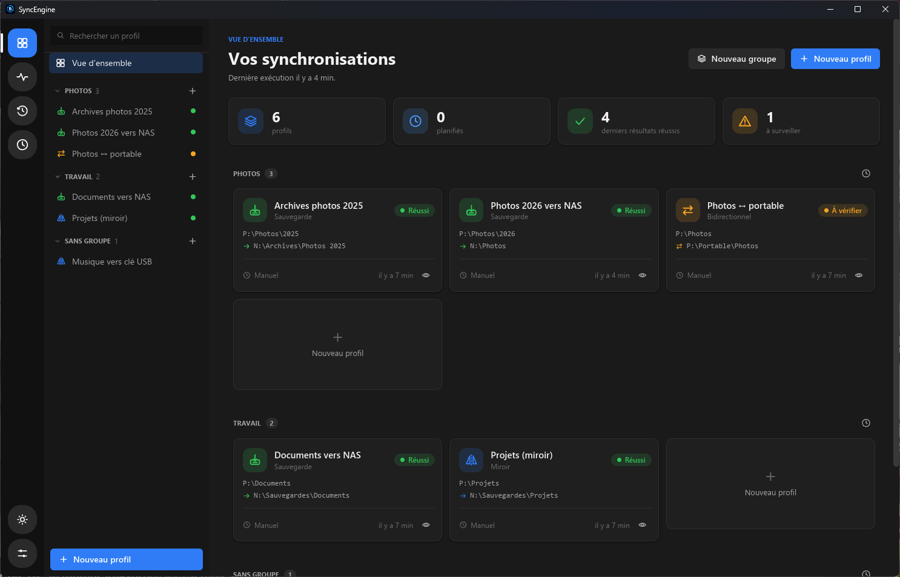
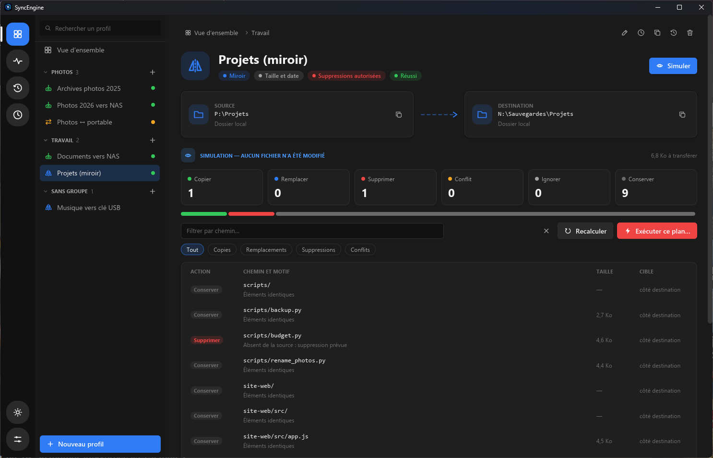
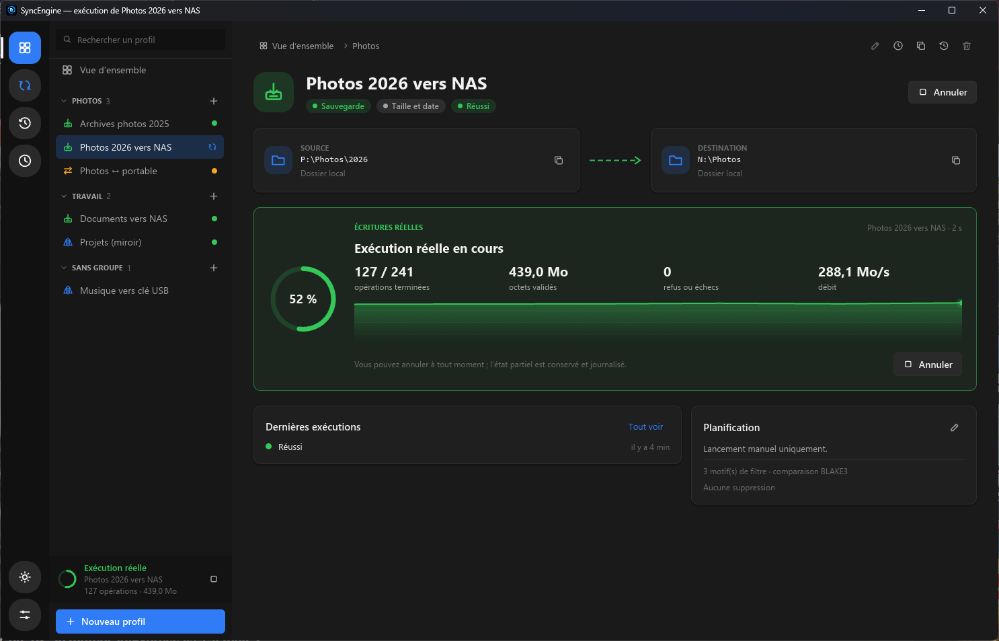

<p align="center">
  <a href="README.md">English</a> ·
  <strong>Français</strong>
</p>

<p align="center">
  
</p>

<h1 align="center">SyncEngine</h1>

<p align="center">
  Sauvegarde, miroir et synchronisation bidirectionnelle natifs pour Windows et Linux :<br />
  d'abord simuler, ensuite copier — sans jamais perdre un fichier sur une supposition.
</p>

<p align="center">
  <a href="https://github.com/sargo22341-prog/SyncEngine/releases/latest"></a>
</p>

## Avertissement

> [!WARNING]
> Cette application a été **développée avec l'aide d'une intelligence artificielle**.
> Le code, les tests et la documentation ont été produits en grande partie par IA puis vérifiés
> par des tests automatisés, mais tout n'a pas été relu ligne à ligne ni validé dans toutes les
> situations réelles. SyncEngine écrit, remplace et peut supprimer des fichiers : essayez-la
> d'abord sur des copies, gardez des sauvegardes indépendantes et consultez les
> [limites connues](#limites-connues).

## Présentation

**SyncEngine** garde des dossiers alignés les uns sur les autres, dans l'esprit de SyncBack ou
de FreeFileSync, avec une priorité nette à la sécurité des données : chaque exécution commence
par une **simulation** qui montre exactement ce qui sera copié, remplacé ou supprimé, et rien
n'est écrit tant que vous n'avez pas confirmé ce plan précis.

Elle est entièrement écrite en Rust : une interface native ([iced](https://iced.rs), sans
WebView), un outil en ligne de commande et un agent sans interface, qui partagent les mêmes
moteurs.

Fonctionnalités principales :

- **trois modes**, chacun avec ses règles :
  - **sauvegarde** : source → destination, ne supprime jamais rien ;
  - **miroir** : rend la destination identique à la source, suppressions seulement avec une
    politique explicite, une confirmation distincte et un plafond contre les suppressions
    massives ;
  - **synchronisation bidirectionnelle** entre deux dossiers locaux, avec un état précédent
    fiable, des tombstones pour les suppressions et des conflits conservés côte à côte au lieu
    d'être écrasés ;
- **simulation avant écriture** : le plan affiché est le plan exécuté, avec un compteur par
  action (copier, remplacer, supprimer, conflit, ignorer, conserver), un motif pour chaque
  chemin, des filtres et une recherche ;
- **garde-fous** : un disque absent, un dossier illisible ou un scan partiel n'est jamais traité
  comme « vide » et ne mène jamais à une suppression ; une destination imbriquée dans sa source
  est refusée ; les préconditions sont revérifiées juste avant chaque écriture ;
- **copies vérifiées** : écriture dans un fichier temporaire puis contrôle (contenu BLAKE3 ou
  taille), versions facultatives des fichiers remplacés et supprimés, journal qui survit à un
  arrêt brutal ;
- **comparaison rapide** : par taille et date (seuls les dossiers sont lus), ou par contenu ;
- **profils et groupes** : assistant en sept étapes (sans JSON), groupes avec glisser-déposer,
  profils avec ou sans groupe, filtres (inclusions, exclusions, dossiers exclus) ;
- **progression en direct** (opérations, octets, débit), annulation à tout moment avec l'état
  partiel conservé et journalisé, et un **historique** de chaque exécution ;
- **planification** par un agent sans interface qui continue quand la fenêtre est fermée, avec
  une autorisation explicite par profil ;
- **connecteurs réseau expérimentaux** : SFTP, WebDAV HTTPS, FTP, FTPS et SMB, plus une
  **source OneDrive en lecture seule** ; ils sont signalés comme expérimentaux dans l'interface ;
- thèmes sombre et clair qui suivent le système, raccourcis clavier, icône dans la zone de
  notification ;
- **aucun compte, aucune télémétrie, aucun service cloud** requis.

### Aperçu

| Vue d'ensemble | Simulation | Copie en cours |
| --- | --- | --- |
|  |  |  |

Les captures utilisent des dossiers, profils et fichiers fictifs.

## Installation

Chaque version est publiée dans les GitHub Releases du dépôt sous forme d'**archive
portable** : la décompresser dans un dossier personnel et lancer `syncengine-desktop`. Les trois
exécutables (interface, ligne de commande, agent) doivent rester côte à côte.

| Système | Fichier |
| --- | --- |
| Windows 11 x86_64 | `SyncEngine_X.Y.Z_x86_64-pc-windows-msvc.zip` |
| Linux x86_64 (compilé sous Ubuntu 24.04) | `SyncEngine_X.Y.Z_x86_64-unknown-linux-gnu.tar.gz` |

Chaque archive ne contient que les trois exécutables, `LICENSE.txt` et `THIRD_PARTY_NOTICES.txt`.
Vérifier le téléchargement avec les empreintes SHA-256 listées à la fin de la description de la
release (`sha256sum FICHIER` sous Linux, `Get-FileHash -Algorithm SHA256 FICHIER` sous PowerShell). Les binaires **ne sont pas signés** :
SmartScreen peut afficher un avertissement au premier lancement.

Aucun droit administrateur n'est nécessaire. Profils, historique et réglages sont dans
`%APPDATA%\org.syncengine.desktop` (Windows) ou `~/.local/share/org.syncengine.desktop` (Linux) ;
supprimer le programme ne les efface jamais.

### Compiler depuis les sources

Prérequis : la chaîne Rust épinglée dans `rust-toolchain.toml` (installée automatiquement par
`rustup`) et, sous Debian/Ubuntu, `build-essential pkg-config libssl-dev zlib1g-dev`.
Détails : [docs/DEVELOPPEMENT.md](docs/DEVELOPPEMENT.md).

```sh
cargo run -p syncengine-desktop                                       # dossiers locaux
cargo build --release -p syncengine-desktop -p syncengine-cli -p syncengine-agent --features network,onedrive
```

## Ligne de commande

Les mêmes moteurs sont disponibles sans interface :

```sh
syncengine preview ./source ./destination                  # plan, rien n'est écrit
syncengine preview ./source ./destination --mode mirror --allow-delete --max-delete 100
syncengine execute ./source ./destination --confirm --journal ./execution-01.jsonl --progress
syncengine journal ./execution-01.jsonl                    # diagnostiquer une exécution
```

Commandes, options et codes de sortie : [docs/CLI.md](docs/CLI.md).

## Documentation

- [Guide d'utilisation](docs/GUIDE.md) : modes, simulation, garde-fous, interface, dossier d'état ;
- [Ligne de commande](docs/CLI.md) ;
- [Planification et agent](docs/PLANIFICATION.md) ;
- [Connecteurs réseau et cloud](docs/CONNECTEURS.md) ;
- [Architecture](docs/ARCHITECTURE.md) ;
- [Développement](docs/DEVELOPPEMENT.md) : compilation, contrôles, publication.

## Limites connues

- L'interface n'existe qu'en **français**.
- Les binaires **ne sont pas signés** et il n'y a pas encore d'installateur : archives portables
  uniquement.
- Les connecteurs réseau et la source OneDrive sont **expérimentaux** : testés contre des
  serveurs de test isolés, pas contre de vrais fournisseurs ni un vrai compte Microsoft. SMB est
  en lecture seule sous Linux. Le bidirectionnel est limité à deux dossiers locaux.
- Les serveurs distants n'offrent pas de transaction globale : une exécution interrompue vers un
  serveur peut laisser un état partiel (toujours journalisé). Éviter que d'autres programmes
  écrivent dans les mêmes dossiers pendant une exécution.
- Les exécutions planifiées demandent des tâches natives : un clic sous Windows, installation
  systemd manuelle sous Linux ; voir [la planification](docs/PLANIFICATION.md).
- Les builds Linux sont vérifiés sous Ubuntu 24.04 en CI ; Debian n'est pas compilé nativement.
- `cargo audit` signale des avertissements (crates non maintenus ou « unsound ») hérités de la
  bibliothèque graphique et de l'icône de notification Linux ; aucune vulnérabilité connue. Tout
  nouvel avertissement bloque la CI ; voir [les avis tolérés](docs/DEVELOPPEMENT.md#avis-rustsec-tolérés).

## Technologies

| Couche | Technologie |
| --- | --- |
| Langage | Rust (édition 2024), workspace de crates à responsabilité unique |
| Interface | iced 0.14 (wgpu, repli tiny-skia), rfd, tray-icon |
| Empreintes | BLAKE3 |
| État | SQLite (rusqlite, migrations versionnées) |
| Réseau | ssh2 (SFTP), reqwest + native-tls (WebDAV, OneDrive), SuppaFTP (FTP/FTPS) |
| Plateformes | Windows x86_64 (MSVC), Linux x86_64 (GNU) |

## Contribuer

Règles de contribution (humains et agents IA) : [`AGENTS.md`](AGENTS.md). Chaque modification de
l'application ajoute une courte ligne dans [`RELEASE_NOTES.md`](RELEASE_NOTES.md) ; la CI en fait
la prochaine GitHub Release. Compilation, contrôles et publication :
[docs/DEVELOPPEMENT.md](docs/DEVELOPPEMENT.md).

## Licence

Copyright © 2026 sargo.

SyncEngine est un logiciel libre, distribué sous la **GNU General Public License, version 3
uniquement** (GPL-3.0-only) : vous pouvez l'utiliser, l'étudier, le modifier et le redistribuer, à
condition que ce que vous distribuez reste sous la même licence, avec son code source. Il est
fourni sans garantie. Texte complet : [`LICENSE`](LICENSE). Les dépendances conservent leurs
licences ; chaque archive inclut leurs notices (`THIRD_PARTY_NOTICES.txt`).

SyncEngine est un projet indépendant, sans lien avec SyncBack, FreeFileSync, Microsoft ou un
quelconque fournisseur de stockage.
